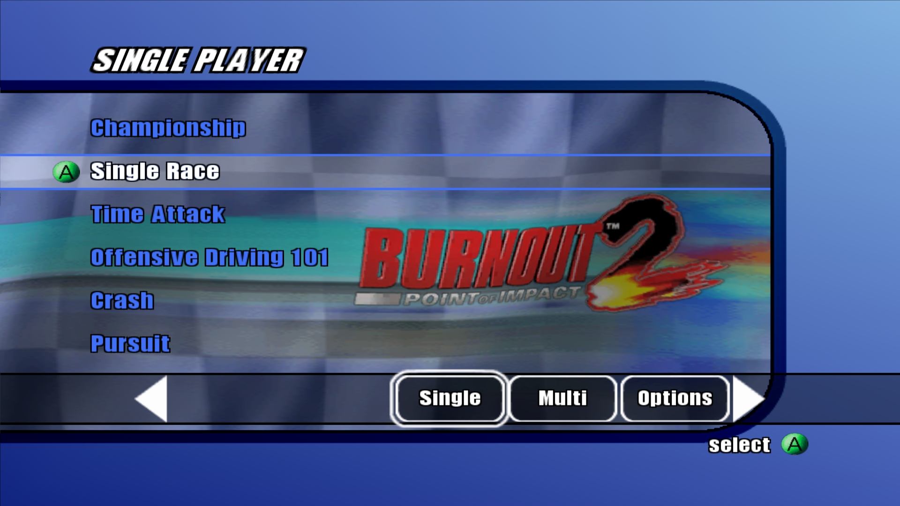
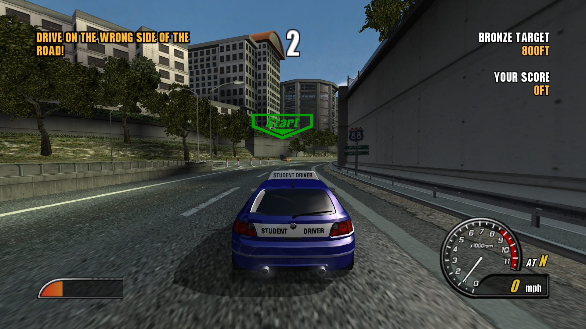
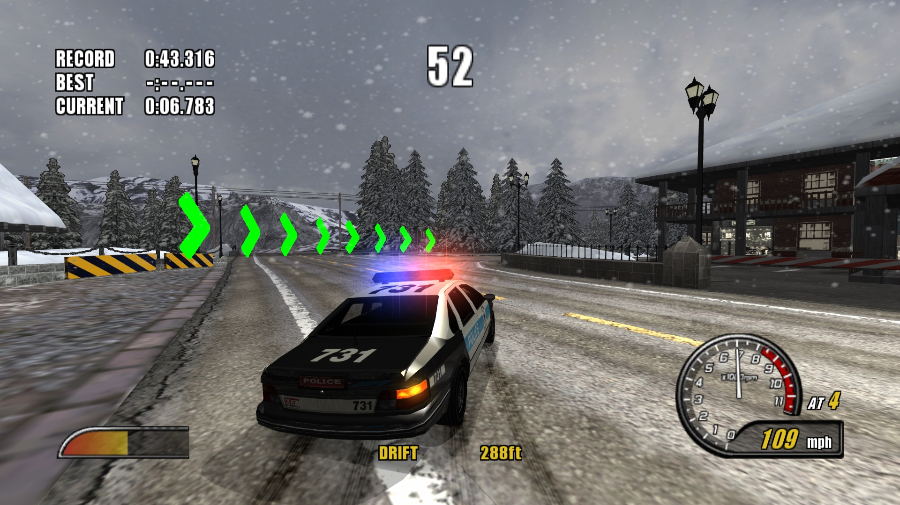
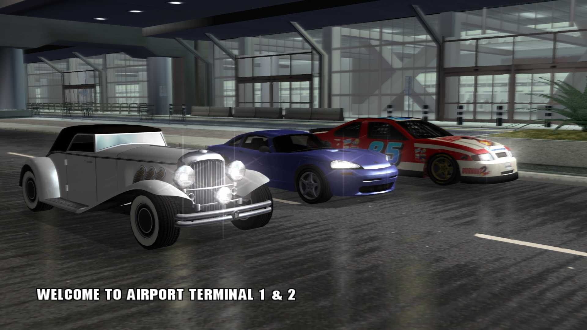

# 
Burnout 2: Point of Impact — Static Recompilation

An unofficial version of the original Xbox game for Windows, with experimental
Linux, Steam Deck, and macOS ports, focused on fast gameplay, preserving the original's look
and feel, and a variety of enhancements.

**Linux, Steam Deck, and macOS builds need testing.** Linux and Steam Deck still need gameplay, sound and
performance checks. macOS needs those checks on both
Intel and Apple Silicon.

<i>Still in development: Slowdown, bugs, and crashes are possible. Open an issue if you experience a problem, and
I'll try to respond in a timely manner. This is an independent fan project, unaffiliated with the game's owners.</i>

## AI Disclosure

Yes, AI (Codex) assisted in the development of this project. No, this project was not blindly thrown together.
If you're skeptical, I implore you to try the recompilation for yourself. I take quality control quite seriously!👀

## What's new in 1.15.0

- **Ready-to-play downloads for every platform.** No more installing build tools or compiling: download **Burnout2-Setup.exe** for Windows, **Burnout2-x86_64.AppImage** for Linux and Steam Deck, or the disk image for your Apple Silicon or Intel Mac.
- **Select your disc and play.** Choosing your disc image in **Game files** now prepares the game executable automatically.

Coming from a source build? See [Updating between releases](#updating-between-releases)
to keep your saves. Your own US Xbox XISO is required. Game files are not included.

## Screenshots

<table>
  <tr>
    <td align="center" width="50%">
       
      Single Player menu
    </td>
    <td align="center" width="50%">
       
      Driving lesson
    </td>
  </tr>
  <tr>
    <td align="center" width="50%">
       
      Snowy track
    </td>
    <td align="center" width="50%">
       
      Airport Terminal 1 &amp; 2
    </td>
  </tr>
</table>

## What happened to the original release?

The original recompilation worked, but its poor performance and growing complexity
led to a fresh start. Its implementation was replaced with a smaller version
focused on speed and simplicity. I couldn't bear to keep the slop version public😅

## Current status

The features below have been validated primarily on Windows. Linux and macOS
support is still being tested.

### What works

- Startup, menus, and many levels/modes.
- Background music, menu sounds and in-game sound effects.
- Creating, saving and loading profiles through the game's Load/Save menu.
- Gamepad and keyboard input.
- Saved settings for display, audio and controls, with refresh rates from 60 Hz
  through **Unlimited**. High-refresh gameplay and menus keep normal game speed.
- Custom keyboard and controller bindings, and 1×–4× internal resolution.
- Native 16:9 and ultrawide 21:9 cameras with the HUD's original proportions
  and edge placement.
- Adjustable camera FOV from 50% to 150%, with the original view at 100%.
- Optional MSAA or FXAA antialiasing and anisotropic filtering up to 16×.
- Optional ambient occlusion with adjustable quality and strength.
- Optional Windows HDR output with adjustable image and highlight brightness.
- Imported custom music through the original Music Selection menu, with a saved
  **Loop Track** option in Music Selection and **Pause → Options**.
- Optional motion blur from the original game.
- Optional intro skipping and 2×/4× draw distance, with detailed traffic and loose
  car parts, plus extended loose-part ground shadows.
- Clean HUD redraws the original low-resolution interface assets with smooth edges.
- Optional fast loading skips loading transitions and frame delays.
- Ten achievements with saved progress and animated unlock notifications.
- Asset replacement mods with saved load order and conflict checks.
- Texture pack installation from Settings and sandboxed Lua scripting with
  supported gameplay events.
- Optional automatic muting when the game loses focus.
- Optional Discord Rich Presence with the project's icon and elapsed time.

### What still needs work

- Testing all modes, tracks and saved-game progression.
- Checking sound balance and consistently smooth performance across the whole game.

## Getting started

All platforms require **your own copy of the US Xbox release** as an XISO disc
image. Game files are not included.

### Windows x64

You need a 64-bit Windows 10 or 11 PC and a graphics card that supports DirectX 11.

1. Download [Burnout2-Setup.exe](https://github.com/timftw21/burnout2-recompilation/releases/latest/download/Burnout2-Setup.exe)
   and run it.
2. Select your US Xbox XISO disc image (`.iso` or `.xiso`). Full-disc dumps need
   conversion to XISO first. Choose an installation folder; you can keep a copy of
   the image with the game and create a desktop shortcut.
3. Click **Install**. Setup checks your image, installs the game and prepares its
   files. Nothing is downloaded and no build tools are needed.
4. Click **Play game**, or launch it later from the Start menu or desktop shortcut.

The default installation folder is `%LOCALAPPDATA%\Programs\Burnout 2 Recompilation`.
If you do not keep a copy of the image, leave it where it is while playing.
Windows SmartScreen or antivirus software may warn about the unsigned setup
program; the published SHA-256 checksum is beside it on the release page.
Uninstall through Windows **Installed apps**. Saves, settings, achievement
progress, imported music, mods and your original image are kept.
To build the game yourself instead, see [BUILDING.txt](BUILDING.txt).

### Linux x86-64 and Steam Deck

You need a 64-bit distribution with glibc 2.38 or newer (for example Ubuntu
24.04+, Debian 13+, Fedora 39+, Arch Linux or current SteamOS) and a Vulkan 1.4
graphics driver.

1. Download [Burnout2-x86_64.AppImage](https://github.com/timftw21/burnout2-recompilation/releases/latest/download/Burnout2-x86_64.AppImage).
2. Allow it to run: in your file manager open **Properties → Permissions** and
   enable **Allow executing file as program** (or run `chmod +x Burnout2-x86_64.AppImage`).
3. Open it. In **Game files**, click **Browse** next to **Game disc image** and
   select your US Xbox XISO. The game prepares its files automatically.
4. Click **Start game**.

Settings, saves, mods and logs are kept in `~/.local/share/burnout2-recompilation`.
Keep the disc image where it is while playing. If your system lacks FUSE, start
the AppImage with `--appimage-extract-and-run`. Linux uses Vulkan through DXVK
Native and runs without Wine. Desktop gameplay, sound and graphics performance
still need testing.

On **Steam Deck**, download the AppImage in Desktop Mode and allow it to run as
above. Add it to Steam with **Add a Non-Steam Game** to play in Gaming Mode;
leave the compatibility-tool override off. Steam Deck support is experimental.

### macOS Apple Silicon and Intel

You need macOS 15 Sequoia or newer and a Mac with a Metal 3 GPU.

1. Download [Burnout2-macOS-AppleSilicon.dmg](https://github.com/timftw21/burnout2-recompilation/releases/latest/download/Burnout2-macOS-AppleSilicon.dmg)
   for M-series Macs, or [Burnout2-macOS-Intel.dmg](https://github.com/timftw21/burnout2-recompilation/releases/latest/download/Burnout2-macOS-Intel.dmg)
   for Intel Macs.
2. Open it and drag **Burnout 2 Recompilation** to **Applications**.
3. Open the app. The app is not notarized by Apple, so macOS blocks the first
   launch: open **System Settings → Privacy & Security**, click **Open Anyway**
   for Burnout 2 Recompilation and confirm.
4. In **Game files**, click **Browse** next to **Game disc image**, select your
   US Xbox XISO, then click **Start game**.

Settings, saves, mods and logs are kept in
`~/Library/Application Support/Burnout 2 Recompilation`. Keep the disc image
where it is while playing. Graphics run through DXMT and Metal, without Wine or
Rosetta. Both architectures still need real gameplay, visual, audio and
performance testing on physical Macs.

Linux and macOS do not support WARP, D3D11 debug layers or hardware memory
watches. Custom music imports require FFmpeg. To build the game yourself on
Linux, Steam Deck or macOS, see [BUILDING.txt](BUILDING.txt).

### Updating between releases

On Windows, close the game and run the newer **Burnout2-Setup.exe**. It selects
your existing installation folder and keeps saves, settings, achievement
progress, imported music and mods. On Linux and macOS, replace the AppImage or
the app with the newer download; your data folder stays as it is.

**Moving from an earlier source build:** close the game, then copy the `data`
and `mods` folders from the folder containing **b2.exe** or **b2** (normally
`build/windows/Release`, `build/linux/Release`, `build/steamdeck/Release` or
`build/macos/Release` in your source folder):

- **Windows:** into a new, empty folder, then run **Burnout2-Setup.exe** and
  choose that folder. Setup keeps the copied saves and settings.
- **Linux and Steam Deck:** into `~/.local/share/burnout2-recompilation`.
- **macOS:** into `~/Library/Application Support/Burnout 2 Recompilation`.

These folders hold your saves (`data/user`), settings and achievements
(`data/local/settings.cfg` and `achievements.cfg`), imported music
(`data/local/custom-music`) and mods. On Linux and macOS, select your disc
image once in **Game files** after copying.

### Game settings

Click **Start game** to play; press **Esc** to open or close settings. Changes
save automatically. Graphics, controls and enhancement changes apply during play.
Mods and imported music use a game restart. Hover over options for details.

- **Game files** — Select your disc image; the game extracts and verifies its
  executable automatically. Click **Import Xbox save…** and select the file named `Profile 1`,
  `Profile 2` or `Profile 3` in your extracted Xbox save folder. The importer
  checks the save and keeps its slot number if available. If that slot is taken,
  it uses another free slot. Open **Load/Save** in the game and choose the
  reported slot. If you imported during play, restart the game first.
- **Restore defaults** — Click the button at the bottom of Settings to restore
  the built-in preferences. Your selected file locations, saves and achievement
  progress are preserved.
- **General:** Set the refresh rate or **Unlimited**, show FPS, and enable
  **Discord Rich Presence**. Presence is off by default and requires Discord desktop.
- **Graphics:** Choose resolution, aspect ratio, camera FOV, V-sync and Windows HDR output.
  Camera FOV uses percentages (50-150%). **100%** or **Reset** restores the
  original view. Camera zoom effects are preserved. Changes apply immediately.
  Enable HDR in Windows first; hover over its controls for brightness guidance.
- **Enhancements:** Set antialiasing, texture filtering, ambient occlusion and
  draw distance. **Miscellaneous** contains Clean HUD, Fast load, Motion blur
  and intro skipping. Higher quality and distance use more resources.
- **Audio:** Set volume and muting, including **Mute on focus loss**. Browse for
  songs, click **Import music**, then choose the collection in **Music Selection**.
  **Loop Track** is in Music Selection and **Pause → Options**.
- **Controls:** Select **Keyboard** or **Controller 1–4**, click a binding, then
  press the new control. Each player keeps separate mappings. Esc cancels capture.
- **Achievements:** View progress, pause tracking or reset achievement progress.
- **Mods:** For texture packs, extract the download, click **Install texture
  pack...**, and select the folder containing `mod.cfg`. The pack is installed
  and enabled automatically; start or restart the game to apply it. Use the
  checkboxes to disable packs and the arrows to change priority. Lower enabled
  packs/mods take priority; **Check mods** validates images and reports conflicts.
  Game file mods can still be added through **Open folder**, then **Refresh**.
  Sandboxed Lua scripts can set session FOV, display messages and react to
  supported gameplay events. Test Mod shows a confirmation at startup and your
  finishing position after a race. Executable patches and arbitrary game-memory
  access are unsupported. See [BUILDING.txt](BUILDING.txt).
- **Diagnostics:** View logs, capture frames or record performance.

Press **F9** to start or stop a performance recording. Reports are saved under
`build/captures/performance-*` in the game's folder; include the whole folder
when reporting a slowdown.

### Achievements

Achievements unlock as you play and are shared across game profiles in the same
installation. Progress is saved in `data/local/achievements.cfg` beside the game
executable. Loading an existing save does not immediately award achievements;
previous medals and completions count toward aggregate goals when you next finish
a relevant event.

| Achievement | Requirement |
| --- | --- |
| Crash + Burn | Earn bronze or better on any Crash Zone. |
| See You in Hell | Earn gold on all Crash Zones. |
| Dangerous Driving | Earn gold on all Offensive Driving 101 lessons. |
| You're Winner ! | Earn first place in any race. |
| Copped Cars | Complete Pursuit 1, Pursuit 2, and Pursuit 3 in Championship mode. |
| Burnout Big Leagues | Complete Championship mode. |
| Burnt Out | Complete Custom Series Championship mode. |
| Started in Second Gear | Activate a starting boost. |
| Burnout x Achievement | Achieve a Burnout x 15 or higher. |
| Stay Frosty | Achieve a time of 0:40.00 or faster on Crystal Summit Peak in Time Attack mode. |

## Controls

Connected gamepads work automatically. Keyboard controls are enabled by default.
Remap either in **Settings → Controls**; settings navigation keeps its standard
controls. The default keyboard bindings are:

| Action | Key |
| --- | --- |
| Accelerate | W |
| Brake | S |
| Steer | A / D |
| Move through menus | Arrow keys |
| A button / Confirm | Space |
| B button / Back | Left Shift |
| Black button | R |
| White button | F |
| Start / Pause | Enter |
| Toggle settings | Esc (or F1) |
| Capture frame | F8 |
| Record / save performance | F9 |

**Black** and **White** refer to the original Xbox controller's extra face buttons.
On modern gamepads, Black defaults to **RB / R1** and White to **LB / L1**.

## Resources and credits

The project builds on preserved research from the first recompilation and checks
discoveries against the game's original executable. Original Xbox video screenshots
provide the visual reference.

- [XboxDevWiki](https://xboxdevwiki.net/Kernel) and
  [nxdk](https://github.com/XboxDev/nxdk): Xbox hardware and system interfaces.
- [xemu](https://github.com/xemu-project/xemu) and
  [Cxbx-Reloaded](https://github.com/Cxbx-Reloaded/Cxbx-Reloaded): references for
  graphics, sound and Xbox system behavior.
- [DSP56300 manual](https://www.nxp.com/docs/en/reference-manual/DSP56300FM.pdf) and
  [mborgerson's DSP56300 toolkit](https://github.com/mborgerson/dsp56300): the
  original sound processor and its instructions.
- [SDL3](https://wiki.libsdl.org/SDL3/FrontPage),
  [Dear ImGui](https://github.com/ocornut/imgui) and
  [Zydis](https://github.com/zyantific/zydis): windows, input, audio, settings and
  instruction decoding during the build.
- [Microsoft's Direct3D 11 documentation](https://learn.microsoft.com/en-us/windows/win32/direct3d11/atoc-dx-graphics-direct3d-11)
  and [Windows API documentation](https://learn.microsoft.com/en-us/windows/win32/api/):
  the Windows graphics and system backend.
- [DXVK Native](https://github.com/doitsujin/dxvk) and
  [DXMT](https://github.com/3Shain/dxmt): native Vulkan and Metal graphics backends.
- [Berkeley SoftFloat](https://www.jhauser.us/arithmetic/SoftFloat.html) and
  [MPFR](https://www.mpfr.org/): floating-point support for Apple Silicon.
- [XeGTAO](https://github.com/GameTechDev/XeGTAO): reference for ambient occlusion.

See [third-party notices](THIRD_PARTY_NOTICES.txt) for dependency licenses and
[research notes](https://github.com/timftw21/burnout2-recompilation/tree/main/research)
for detailed findings and source links.
